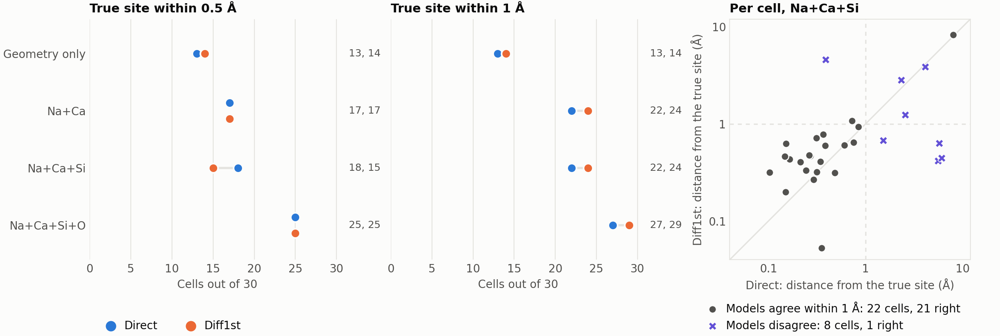
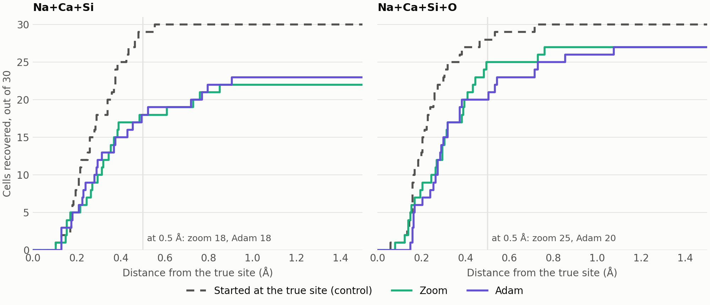

# NMR structure resolution of Na in C-S-H: results

Last updated: 2026-11-01. Newest entries in §7. Update the status block and the tables when results change.

## Status

- **Best result so far** (30 bulk test cells, DFT target, one Na placed, framework fixed), Direct: true site
  within 0.5 Å in **18/30** with Na+Ca+Si, **25/30** adding O; in the top 3 minima in **29/30** and **30/30**.
  Diff1st: 15/30 and 25/30, top 3 28/30 and 30/30.
  Previous result: 0/9 (September, old model, whole-cell Adam).
- **What changed the result:** mainly the ensemble and the χ² loss. Every single model has unphysical decoys, in
  different places, so averaging models removes them. Pair guards remove them too and cut the evaluations 15×, but on
  the 6 cells tested they add almost no recoveries (§2.3, §3.1). The new checkpoints' share is not separated from
  these. The old conclusion "needs a model below 1 ppm" no longer holds: sites are recovered here with a Na error
  of 4 ppm.
- **Main caveat:** the framework is relaxed around the true Na, so the cavity gives the site away. Geometry alone,
  with no spectrum, finds 13/30. The increment due to NMR is 13 → 18 (Na+Ca+Si) or 13 → 25 (with O).
- **Model choice:** with a known reference Direct and Diff1st cannot be told apart on 30 cells (§2.5). With an uncertain
  σ → δ reference, the realistic case, Diff1st holds up better: 25/29 against 21/24 at 2 ppm with O, 15/26 against
  7/18 with no reference and Na+Ca+Si (§2.8). Not significant on 30 cells (p ≥ 0.06), but every row points the same
  way. This reverses the earlier advice to search with Direct alone: use both, since forward runs fit on 8 GB.
- **Best confidence signal: the two models agreeing.** With Na+Ca+Si, when their best points are within 1 Å the
  answer is right in 21/22 cells, otherwise in 1/8 (§2.5). It holds on the cells geometry alone gets wrong (11/12).
- **The search is not the limit.** Adam on the ensemble gives no gain over the forward zoom from the same seeds
  (18 vs 18 at 0.5 Å with Na+Ca+Si, 20 vs 25 with O). Every wrong answer has a lower χ² than the minimum at the true
  site, so a better optimiser cannot fix it (§2.6).
- **Surfaces are much harder:** 1/6 with Na+Ca+Si, 4/6 from the Na peak alone, 0/6 from geometry (§2.9).
- **Running:** nothing. The cavity test with MACE-MP is prepared but not run, so the leak is still unmeasured (§6).
- **Code and data:** `csh_nmr/ensemble_search/`, untracked. Run every script from that folder.

## 1. Setup of the current test

- **Models:** `nmr_project/jz_runs/q1_kfold_v2/csh/`, Direct / Diff1st / Diff2nd(μB), r4 l3 mul32 n4, 5 folds,
  best-validation checkpoint. Data: `Na_csh_filtered.json`. Test set: 36 cells shared by all folds
  (30 bulk, 6 surface), `GroupedKFoldSplit(seed=42)`.
- **Method: forward only, no gradients.** Coarse grid (0.5 Å) over the points a Na can occupy, seeds from the
  best points, two zoom levels (14-point stencil, 0.2 then 0.08 Å). σ_iso of every atom at every candidate is
  saved per model, so losses and nuclei are compared offline.
- **Guards:** nearest Na-X distance in the data (381 Na sites): O 2.18, H 2.18, Si 2.78, Ca 2.95, Na 3.08 Å.
  Tiers: tight (minimum − 0.1 Å), soft (×0.9), loose (×0.8).
- **Loss:** assignment-free χ²: per nucleus, sort the peaks and sum `(Δδ/ε)²`, with
  ε = Na 2.5, Ca 2.7, Si 1.5, O 3.8, H 0.55 ppm (Diff1st ensemble test RMSE).
- **Scored against truth only at the end.** "Recovered" = lowest-loss point within the stated distance of the true
  site. Top 3 = the true site is among the 3 best minima separated by more than 1 Å.

## 2. Results

Direct, ensemble of 3 folds, 30 bulk cells, DFT target, soft guards unless stated. Coarse grid about 290 points.

### 2.1 Guards and baseline

| | < 0.5 Å | < 1 Å | top 3 | median \|Δr\| (Å) |
|---|---|---|---|---|
| Geometry only (roomiest point, no spectrum) | 13 | 13 | 24 | 2.74 |
| Na+Ca+Si, loose | 17 | 21 | 28 | 0.43 |
| Na+Ca+Si, soft | 18 | 22 | 29 | 0.38 |
| Na+Ca+Si, tight | 19 | 24 | 29 | 0.36 |

### 2.2 Loss, ensemble, nuclei, target

| | < 0.5 Å | < 1 Å | top 3 | median \|Δr\| (Å) |
|---|---|---|---|---|
| **Loss, coarse grid only (same candidates, fair):** | | | | |
| χ² Na+Ca | 21 | 26 | 28 | 0.37 |
| W1 Na+Ca | 11 | 15 | 25 | 0.97 |
| χ² Na+Ca+Si | 22 | 25 | 29 | 0.38 |
| W1 Na+Ca+Si | 11 | 15 | 27 | 0.97 |
| **Ensemble:** | | | | |
| Single fold 0 / 1 / 2 | 17 / 15 / 14 | 21 / 21 / 19 | 30 / 27 / 28 | 0.44 / 0.51 / 0.55 |
| Ensemble of 3 | 18 | 22 | 29 | 0.38 |
| Ensemble of 5, zoomed points only | 19 | 24 | 29 | 0.40 |
| **Nuclei (χ²):** | | | | |
| Na | 13 | 15 | 23 | 1.13 |
| Na+Si | 10 | 15 | 25 | 0.97 |
| Ca+Si (no Na) | 8 | 17 | 26 | 0.81 |
| Na+Ca | 17 | 22 | 28 | 0.40 |
| Na+Ca+Si | 18 | 22 | 29 | 0.38 |
| Na+Ca+Si+O | 25 | 27 | 30 | 0.31 |
| All (with H) | 21 | 25 | 29 | 0.39 |
| **Target:** | | | | |
| Self (ensemble at the true site) | 27 | 29 | 30 | 0.17 |
| Held-out model (fold 4 at the true site) | 17 | 21 | 28 | 0.39 |

W1 here is the branch's loss without line broadening. Seeds were always chosen with χ² Na+Ca+Si, so for the
other nuclei and for W1 the zoomed points are not their own best seeds. Only the coarse-grid rows compare two
losses fairly.

Precision, Na+Ca+Si+O: < 0.2 Å 8/30, < 0.3 Å 14/30, < 0.5 Å 25/30, < 1 Å 27/30. The χ² minimum nearest the
true site sits 0.2-0.3 Å from it. Adam confirms this is the model's own offset, not a limit of the zoom (§2.6). The
old 0.2 Å threshold is too strict for these errors.

### 2.3 Control: pair guards against the ensemble

Direct, χ² Na+Ca+Si, DFT target, first 6 cells. Without pair guards: whole cell, 0.65 Å guard only, 0.6 Å grid, about
4300 points, 6 seeds. With: soft guards, 0.5 Å grid, about 290 points, 10 seeds. Cells within 0.5 Å, out of 6:

| | No pair guards | Soft guards |
|---|---|---|
| Single fold 0 / 1 / 2 | 4 / 1 / 2 | 4 / 2 / 2 |
| Ensemble of 3 | 5 | 5 |

- The ensemble gives the gain here; the guards do not. Best point inside the soft guards without pair guards: folds
  0 / 1 / 2 give 6 / 2 / 2 out of 6, the ensemble 6/6.
- W1 without pair guards, ensemble of 3: 4/6.
- The margin is thin. Even with the ensemble, the best point with an atom closer than 1.5 Å beats the true site in
  2/6 cells (median loss ratio 1.08), 3/6 with W1.
- Guards still pay: 15× fewer evaluations, and they stop a single bad model from landing on an unphysical point.
- Limits: these 6 cells are easy (geometry alone 4/6), and a 0.6 Å grid can miss narrow wells that a gradient descent
  would find. Whether guards matter on the hard cells is not tested.

### 2.4 What a geometry-blind run can report

Ensemble of 3, soft guards. Each cell: Direct / Diff1st. "Right" = best point within 1 Å of the true site.

| | Na+Ca+Si | Na+Ca+Si+O |
|---|---|---|
| χ² at the true site / n_sites, median | 0.71 / 0.76 | 0.49 / 0.46 |
| Truth in the set, Δχ² ≤ 4 (median set size) | 27 (1) / 28 (2) | 29 (1) / 29 (1) |
| Truth in the set, Δχ² ≤ 15 (median set size, max) | 30 (3, 12) / 30 (6, 20) | 30 (2, 7) / 30 (3, 14) |
| Gap to the runner-up, right / wrong answers (median) | 6.4, 1.5 / 2.9, 2.8 | 8.8, 3.4 / 7.2, 4.9 |
| Cells with gap ≥ 7: answered, right | 12, 11 / 5, 5 | 18, 18 / 16, 16 |
| Cells with gap ≥ 4: answered, right | 16, 14 / 10, 9 | 22, 21 / 23, 22 |
| Absolute χ²/n_sites, right / wrong | 0.60, 0.66 / 0.58, 0.65 | 0.46, 0.53 / 0.42, 0.51 |

- **The gap is a model-dependent signal.** It separates right from wrong on Direct, and on both models with O. On
  Diff1st with Na+Ca+Si it does not (2.9 vs 2.8). It remains the best signal from a single model; the absolute loss
  separates much less.
- **Agreement between the two models works better** (§2.5).
- χ² is not a calibrated probability: sorting the peaks lowers the residuals, so it sits below 1 per site. The
  thresholds were read off these same 30 cells.

### 2.5 Diff1st against Direct, same 30 cells

DFT target, soft guards, ensemble of 3 unless stated. Each column: < 0.5 Å / < 1 Å / top 3. "Discordant" counts the
cells at 0.5 Å that only one model gets, with the exact sign test.

| | Direct, all 30 | Diff1st, all 30 | Discordant (Direct, Diff1st; p) | Direct, 18 harder | Diff1st, 18 harder |
|---|---|---|---|---|---|
| Geometry only | 13 / 13 / 24 | 14 / 14 / 23 | 0, 1; 1.00 | 6 / 6 / 15 | 6 / 6 / 15 |
| χ² Na+Ca+Si | 18 / 22 / 29 | 15 / 24 / 28 | 5, 2; 0.45 | 10 / 13 / 17 | 8 / 13 / 17 |
| χ² Na+Ca | 17 / 22 / 28 | 17 / 24 / 29 | 5, 5; 1.00 | 9 / 12 / 16 | 11 / 13 / 17 |
| χ² Na+Ca+Si+O | 25 / 27 / 30 | 25 / 29 / 30 | 2, 2; 1.00 | 16 / 17 / 18 | 15 / 17 / 18 |
| χ² Na+Ca+Si, coarse grid only | 22 / 25 / 29 | 16 / 23 / 28 | 10, 4; 0.18 | 12 / 14 / 17 | 10 / 14 / 18 |
| χ² Na+Ca, coarse grid only | 21 / 26 / 28 | 15 / 21 / 29 | 9, 3; 0.15 | 10 / 14 / 16 | 10 / 13 / 17 |
| W1 Na+Ca+Si, coarse grid only | 11 / 15 / 27 | 13 / 17 / 26 | 7, 9; 0.80 | 5 / 8 / 16 | 8 / 11 / 15 |
| χ² Na+Ca+Si, ensemble of 5, zoomed | 19 / 24 / 29 | 18 / 23 / 30 | 7, 6; 1.00 | 11 / 15 / 18 | 10 / 13 / 18 |
| Self target | 27 / 29 / 30 | 23 / 28 / 30 | 5, 1; 0.22 | 15 / 17 / 18 | 13 / 16 / 18 |
| Held-out model target | 17 / 21 / 28 | 19 / 23 / 27 | 3, 5; 0.73 | 11 / 12 / 16 | 10 / 12 / 15 |

- **No detectable difference between the models.** Every p is above 0.1, before any correction for testing ten
  variants, at 0.5 Å and at 1 Å alike. Diff1st's lower Na error (2.44 vs 4.35 ppm) does not carry over to site recovery.
  30 cells can only exclude a large difference.
- **The coarse-grid advantage of Direct was mostly the first 12 cells:** 10 vs 6 there, 12 vs 10 on the other 18, and
  25 vs 24 once O is in. Not significant, so the earlier "not understood" has no effect left to explain.
- **The 18 cells carry the NMR gain, as expected:** at 0.5 Å geometry finds 6/18 and NMR with O 15-16/18, against
  7-8/12 → 9-10/12 on the first 12.
- **Diff1st depends more on the guards:** loose / soft / tight 10 / 15 / 14 at 0.5 Å, against 17 / 18 / 19 for Direct.
- Geometry-only differs between columns on the same cells because the zoom adds different candidates to each.

Mixing the models does not help. The coarse grid is identical in the two sweeps, so σ_iso can be averaged over the
3 + 3 folds: < 0.5 Å in 18/30 (Na+Ca+Si) and 21/30 (with O), against 22 and 25 for Direct alone. This is coarse
grid only.

Agreement between the models is the best confidence signal found, and needs no truth. Best point of each model,
then check whether they are within 1 Å; right = Direct's answer within 1 Å of the true site:

| | Agree: cells, right | Disagree: cells, right | Same number of cells picked by Direct's gap: right |
|---|---|---|---|
| Na+Ca+Si | 22, 21 | 8, 1 | 20/22 |
| Na+Ca+Si+O | 28, 27 | 2, 0 | 25/28 |
| Na+Ca+Si, cells geometry alone misses (17) | 12, 11 | 5, 1 | |
| Na+Ca+Si+O, cells geometry alone misses (17) | 17, 16 | 0, 0 | |

Agreeing within 0.5 Å is stricter: 11/30 cells with Na+Ca+Si, 20/30 with O, all right at 1 Å. It is not just the
shared cavity leak, since it holds on the cells geometry misses. The two models share their training data, so this
measures agreement of correlated errors, and it has one miss in 22. As measured it needs both full sweeps; running
Diff1st only on Direct's top minima is not tested.

### 2.6 Adam against the zoom

[Animation of the descents on cell 204](figures/descent_cell_204.gif), Na+Ca+Si: the seeds in the cell, χ² per step, and
the peaks against the target. Cell chosen as the recovered cell closest to the medians of |Δr| and gap (0.28 Å, 5.2);
it is a typical success, and 12 of the 30 cells are not recovered within 0.5 Å. `p3_gif.py <cell>` draws any other.

Adam, 100 steps, step 0.04 → 0.004 Å, on the mean of 3 Direct folds, DFT target, soft pair guards as a wall, from the
same seeds as the zoom. The candidates are the points visited inside the guards. "True-site start" is the same descent
from the true site, an oracle control and never a candidate. Cells out of 30.

| | < 0.2 Å | < 0.3 Å | < 0.5 Å | < 1 Å | top 3 | median \|Δr\| (Å) |
|---|---|---|---|---|---|---|
| Na+Ca+Si, zoom | 5 | 10 | 18 | 22 | 29 | 0.38 |
| Na+Ca+Si, Adam | 5 | 12 | 18 | 23 | 28 | 0.40 |
| Na+Ca+Si, true-site start | 8 | 18 | 29 | 30 | | 0.27 |
| Na+Ca+Si+O, zoom | 8 | 14 | 25 | 27 | 30 | 0.31 |
| Na+Ca+Si+O, Adam | 6 | 15 | 20 | 26 | 30 | 0.31 |
| Na+Ca+Si+O, true-site start | 13 | 23 | 28 | 30 | | 0.21 |

- **No gain from the descent.** Adam lowers χ² in 29/30 and 30/30 cells (median by 0.40 and 0.85), but the median
  distance from the true site does not move, and within a cell the two answers differ by a median of 0.05 Å. No paired
  comparison reaches p < 0.05. The closest is with O at 0.5 Å: 5 cells for the zoom only, 0 for Adam only, p = 0.06.
- **That 25 → 20 overstates the loss.** Three of the 5 cells only cross the threshold (0.48 → 0.53, 0.49 → 0.54,
  0.31 → 0.50 Å). The other two (0.32 → 0.85, 0.24 → 1.07 Å) change minimum, with a χ² difference of about 1 between
  the rivals, below what this loss can resolve.
- **The search is not the limit.** Every wrong answer (> 1 Å, 7 with Na+Ca+Si, 4 with O) has a lower χ² than the
  polished minimum at the true site, so none is a search failure. This test uses the oracle, so it is validation only.
- **The precision floor is the model's.** Started at the true site, the descent settles a median of 0.27 Å away (0.21 Å
  with O), so a sharper optimiser cannot do better than that.
- **Pair guards still matter for a descent:** 26-27% of the descents end against them, so the loss pulls the Na towards
  atoms, where the data has no Na (§3.1). Descents without guards were not run.
- **Confidence after the descent.** Adam's answer and Diff1st's within 1 Å: 22 cells, all right; otherwise 8, 1 right
  (Na+Ca+Si). With O: 27, 26 right; otherwise 3, 0 right. Gap ≥ 7: 11 cells, 10 right; with O 20, 20 right. A large gap
  can still be wrong: cell 299 is 7.4 Å off with a gap of 13.3 (Na+Ca+Si). Model agreement flags it.
- **Numerics:** no step of any trajectory overflowed the neighbour capacity; the same check finds the known overflows
  on the sweep. χ² over the last 10 steps varies by at most 0.15 (0.60 with O). Cell 89's consistency check of 0.617 ppm
  came from an overflowed sweep point, fixed afterwards (§3.4).
- **Limits:** one Adam setting, not scanned; Direct only; seeds picked with Na+Ca+Si, so they are not the best for O.

### 2.7 How the models respond to moving the Na, without DFT

From the 15 points saved around each true site: J = ∂σ_iso/∂x_Na, fitted on the ±0.2 Å stencil. Agreement between
models is not agreement with DFT, because they share training data, but it bounds what can be trusted.

| Nucleus | Median \|J\| per atom (ppm/Å) | Fold-fold, Direct | Fold-fold, Diff1st | Direct-Diff1st |
|---|---|---|---|---|
| Na | 17.4 | 0.75 | 0.60 | 0.95 |
| Ca | 1.02 | 0.47 | 0.62 | 0.72 |
| O | 0.86 | 0.35 | 0.46 | 0.60 |
| Si | 0.36 | 0.10 | 0.36 | 0.21 |
| H | 0.11 | 0.14 | 0.42 | 0.52 |

Correlations of J, median over 30 cells. On the 5 most responsive framework atoms of each cell: 0.55, 0.61, 0.75.

- **The framework response is only partly reproducible,** and better on Diff1st on every framework nucleus. On Direct
  the Si response is essentially noise (0.10), which is why Si adds nothing (§3.5).
- **Far from the true site the models diverge:** soft candidates more than 1 Å away have σ_Na lower than at the true
  site by a median of 21.7 ppm on Direct and 5.3 on Diff1st. Which is right needs DFT. On Direct much of the
  discrimination comes from this drop, in the region the model never saw (§3.1).
- **Precision floor.** From the residual at the true site and J, the linear prediction of the offset of the local
  minimum has a median cosine with the observed one of 0.79 with O (0.58 without), and magnitudes 0.27 vs 0.21 Å (0.53 vs
  0.27 Å). So with O the floor is largely the error at the true site projected on the response; magnitudes
  correlate poorly across cells, so this is partial.
- **Information per nucleus** (Fisher, Direct): Na 74%, Ca 18%, Si 9%; with O: Na 46%, O 31%, Ca 13%, Si 7%. The local
  precision rests mostly on the one peak most exposed to the reference.
- **Accuracy needed.** The Cramér-Rao estimate is 0.35 Å with O, above the observed 0.21 Å because ε exceeds the sorted
  residuals, so this is conservative: 0.1 Å needs about Na 0.7, Ca 0.8, Si 0.4, O 1.1 ppm. This applies to the precision
  around the right site. Finding the site does not need it, as the 2 to 4 ppm errors here show.

### 2.8 More realistic targets

Same saved candidates, ensemble of 3, soft guards, cells < 0.5 / < 1 Å. Seeds were picked with the plain χ², which
favours the plain χ² rows slightly.

Uncertain reference: one offset per nucleus, fitted with a prior of width τ (ppm).

| | τ = 0 | τ = 1 | τ = 2 | τ = 4 | free |
|---|---|---|---|---|---|
| Na+Si, Direct | 10 / 15 | 14 / 19 | 13 / 18 | 14 / 19 | 5 / 13 |
| Na+Si, Diff1st | 10 / 14 | 12 / 17 | 12 / 17 | 12 / 17 | 8 / 14 |
| Na+Ca, Direct | 17 / 22 | 19 / 22 | 18 / 22 | 17 / 22 | 6 / 17 |
| Na+Ca, Diff1st | 17 / 24 | 19 / 24 | 19 / 24 | 18 / 24 | 12 / 23 |
| Na+Ca+Si, Direct | 18 / 22 | 19 / 23 | 18 / 22 | 17 / 22 | 7 / 18 |
| Na+Ca+Si, Diff1st | 15 / 24 | 17 / 27 | 17 / 27 | 17 / 27 | 15 / 26 |
| Na+Ca+Si+O, Direct | 25 / 27 | 21 / 24 | 21 / 24 | 20 / 26 | 15 / 23 |
| Na+Ca+Si+O, Diff1st | 25 / 29 | 25 / 29 | 25 / 29 | 24 / 28 | 18 / 25 |

- **Fit the offset.** A prior of 1-4 ppm costs little and sometimes helps: Na+Si goes from 10 to 12-14. It also absorbs
  each cell's mean error.
- **With no reference the Na peak is lost,** since one peak has no information once its offset is free, and Direct falls
  from 18/22 to 7/18 while Diff1st stays at 15/26 (Na+Ca+Si). Discordant cells: 12 for Diff1st, 4 for Direct at 0.5 Å
  (p = 0.08), 11 vs 3 at 1 Å (p = 0.06). At τ = 2 with O: 5 vs 0 at 1 Å (p = 0.06).
- **Model agreement survives** (within 1 Å, right = Direct's answer): τ = 2, 22 cells, 21 right; free, 13 cells, 13 right.
  With no reference, when they disagree Diff1st is right in 13/17, Direct in 5/17.
- **An unnoticed wrong reference is asymmetric:** all four nuclei shifted by −2 ppm take Direct from 25/27 to 8/17, by
  +2 ppm to 26/28 (Diff1st 13/20 and 22/26). The cause is on Ca, Si and O, not Na: moving the Na away lowers the
  framework σ on average (Ca −0.8, O −0.5 ppm on Direct), so a negative shift looks like a displaced Na. Na alone
  shifted by ±4 ppm costs little (Direct 21-23 at 0.5 Å). So an offset should be fitted, not assumed.
- **Noise on the peaks** barely matters: Direct with O goes 25 → 22.6 / 19.1 cells at 1 / 3 ppm (Diff1st 22.1 / 16.6).
- **ε is not tuned to the result:** Direct's own RMSE, equal weights, Na ε ×0.5 or ×2 all stay within 16-18 (Na+Ca+Si,
  Direct) and 14-17 (Diff1st). Only O ε ×2 costs with O (25 → 19), since O then counts less.

Broadened spectra, no peak list: normalised L2 between the two spectra, coarse grid only, cells < 0.5 / < 1 Å / top 3.
FWHM Na 8, Ca 6, Si 3, O 6 ppm.

| | Peak list, Direct | Broad, Direct | Peak list, Diff1st | Broad, Diff1st |
|---|---|---|---|---|
| Na+Si | 11 / 14 / 26 | 13 / 17 / 27 | 13 / 16 / 22 | 10 / 13 / 20 |
| Na+Ca | 21 / 26 / 28 | 11 / 15 / 29 | 15 / 21 / 29 | 13 / 18 / 26 |
| Na+Ca+Si | 22 / 25 / 29 | 12 / 17 / 28 | 16 / 23 / 28 | 13 / 20 / 25 |
| Na+Ca+Si+O | 25 / 28 / 29 | 19 / 24 / 30 | 24 / 28 / 30 | 17 / 23 / 29 |

- **Resolved peak lists are not essential:** with overlapping lines the true site is still in the top 3 in 25-30/30
  cells with Ca or O, and Na+Si, the realistic pair, does not get worse on Direct. The first answer is less precise.
- **Lines narrower than the model error fail** (at Si 0.5 ppm, 3/30): spectra do not overlap and L2 goes flat. That
  is a limit of this loss, not of sharp experimental data: broaden to at least the model error.
- **Limits:** the widths are round numbers, not fitted to measured C-S-H spectra, and all lines have one width. ²³Na
  remains a single Gaussian here, with no quadrupolar lineshape.

### 2.9 Surfaces

Direct, 6 surface test cells, 177-187 atoms, one Na each, ensemble of 3, DFT target, soft guards. Points limited to
3.2 Å from an O, to keep the search out of the vacuum: about 1050 points against 290 in the bulk. Diff1st not run.

| | < 0.5 Å | < 1 Å | top 3 | median \|Δr\| (Å) |
|---|---|---|---|---|
| Geometry only | 0 | 0 | 0 | 7.49 |
| Na | 4 | 4 | 4 | 0.44 |
| Na+Ca | 2 | 2 | 2 | 3.09 |
| Na+Ca+Si | 1 | 2 | 3 | 3.80 |
| Na+Ca+Si, coarse grid only | 2 | 3 | 5 | 1.95 |
| Na+Ca+Si+O | 0 | 1 | 2 | 5.23 |
| Self target, Na+Ca+Si | 2 | 2 | 4 | 1.68 |

- **Much harder than the bulk,** and with no geometric shortcut: geometry alone finds none. But 6 cells say little.
- **The self target fails too (2/6),** so with a perfect spectrum the framework nuclei still do not locate the Na. The
  response is weak or the surface has many equivalent sites; which of the two is not settled.
- **Adding nuclei makes it worse,** the reverse of the bulk: 4 → 0 at 0.5 Å from Na alone to Na+Ca+Si+O. ε comes from
  bulk-dominated test errors, so the framework nuclei are probably overweighted here. Not tested.
- **Na alone at 4/6 needs care.** It may be the same effect as in §2.7: a Direct σ_Na that is right only at relaxed
  sites would pick those sites out without any real spectral information. Diff1st would test this.

## 3. Findings

### 3.1 Unphysical decoys are real, and specific to each model

The old guard (0.5 Å + 0.15 margin, inherited from QM9) leaves 90% of the cell open. Pair guards from the data leave
1.4% (soft) or 0.35% (tight), with a median of 16 and 4 pockets per cell; the true site is reachable in all 30 sampled
cells. Of the 22 old grid-search runs, 13 saved a bundle with positions:

- all 3 DFT-target bundles had their best cluster 0.81-0.89 Å from an atom (Ca, O or H), with loss 0.09-0.57 against
  3.49-5.79 at the true site;
- in all 13, only 4-11% of the clusters were physically admissible.

The model extrapolates there: it never saw a Na closer than 2.18 Å to anything. The September runs used one model,
and the control (§2.3) shows why that matters: without pair guards, two of three single folds land outside the soft
guards in 4/6 cells, the ensemble in none. The folds disagree most where the Na has never been:

| Nearest atom (Å) | 0.65-1.0 | 1.0-1.5 | 1.5-2.0 | 2.0-2.5 | true site |
|---|---|---|---|---|---|
| Std between 3 folds, σ_iso Na (ppm) | 13.7 | 10.1 | 9.3 | 7.8 | 4.4 |
| Std between 3 folds, σ_iso Ca (ppm) | 3.4 | 2.9 | 2.8 | 2.4 | 2.0 |

So each model's decoys sit in different places and the average removes them. The fold spread could itself serve as
an extrapolation signal, with no distance threshold; not tested. The 9 cells behind "0/9, model-limited" saved no
positions, so that they failed this way remains an inference.

### 3.2 Loss

W1 averages nuclei with equal weight and has a V-shaped minimum. χ² weights each nucleus by its error and is smooth
at the minimum. On identical candidates it doubles the recoveries on Direct (22 vs 11, 30 cells); on Diff1st the gain
is smaller (16 vs 13 at 0.5 Å, 23 vs 17 at 1 Å, 30 cells).

### 3.3 Model errors

σ_iso test RMSE (ppm), 36 cells, single fold mean → ensemble of 5:

| | Na | Ca | Si | O | H |
|---|---|---|---|---|---|
| Direct | 6.51 → 4.35 | 4.19 → 3.25 | 2.08 → 1.61 | 4.91 → 4.06 | 0.88 → 0.65 |
| Diff1st | **4.13 → 2.44** | 3.48 → 2.67 | 1.80 → 1.47 | 4.65 → 3.78 | 0.63 → 0.53 |
| Diff2nd μB | 5.75 → 3.73 | 3.57 → 2.70 | 1.87 → 1.47 | 4.68 → 3.97 | 1.07 → 0.82 |
| All 15 models | 2.58 | 2.34 | 1.26 | 3.46 | 0.52 |

The headline RMSE hides this: the test RMSEs of the three models differ by 4%, their Na error by 58%. Even so, the
lower Na error gave no detectable gain in recovered sites on 30 cells (§2.5). One possible reading is that recovery
is limited by the response of σ_iso to the Na position, not by its error at the true site; that response has never
been checked against DFT (§4). There are only 39 Na sites in the test set, so the Na figures are noisy.

### 3.4 Numerics

- **TF32:** under a 1-lane `vmap`, the path Adam uses, σ_iso differs from the saved predictions by up to 0.66 ppm;
  0.06 ppm with `JAX_DEFAULT_MATMUL_PRECISION=highest`. Without `vmap`, 0.006 ppm on Direct. On Diff2nd under TF32
  a 1 mÅ move of the Na changes nothing (std 0.000), with `highest` 0.021 ppm. The scripts do not set this. It may be
  part of the "float32 noise" that killed BFGS; not tested.
- **Neighbour capacity:** the sweeps sized it on 24 random probes, too few. It overflowed silently at 25 points of
  Direct and 21 of Diff1st (about 0.15% of all points, in 9 of 30 cells), which changed σ_iso there by up to 9.6 ppm.
  All were recomputed with a sufficient capacity (control point: 0.0004 ppm). No recovery count changes, in any of the
  21 variants compared; only one Direct cell moves, and it stays on the same side of the thresholds. Direct's gap
  statistics in §2.4 and §2.5 moved slightly and are already updated. Seeds were chosen before the fix, so they could
  differ slightly. A real run must size the capacity on every candidate. Too much is also a problem: the +8 bump on
  overflow gave 41 where 33 is enough, and on 172 atoms that ran out of memory.
- **Memory (8 GB):** a position gradient works on Direct only (0.034 s); Diff1st and Diff2nd run out of memory
  (2-6 GB single allocations) on 71 atoms. A `vmap` of 8 lanes runs out of memory on Direct too.
- **Speed:** forward at `highest`, 71 atoms: Direct about 0.02 s, Diff1st 0.10 s, Diff2nd 0.24 s. One cell with 5 folds
  takes 1-3 min (Direct) and 4-7 min (Diff1st; 12.5 min at 172 atoms). Forward-only search works with every model.
  Adam on 3 Direct folds adds 5-6 min per cell (13 min at 172 atoms, one fold at a time to fit in 8 GB).

### 3.5 Companion nuclei

Ca adds more than Si (Na+Ca 17, Na+Si 10, the same on both models), which agrees with the September sensitivity scan.
Si adds little on top of Ca (Direct 17 → 18, Diff1st 17 → 15); O adds a lot (→ 25 on both). H makes it worse under
these ε (Direct 25 → 21, Diff1st 25 → 23).

## 4. Caveats

- **Cavity leak.** A real framework is not relaxed around the Na being placed, so every number here is optimistic.
  Not quantified beyond the geometry-only baseline.
- **Resolved peaks.** The χ² needs a peak list per nucleus: every Ca, Si and O line resolved. Real MAS spectra overlap,
  and ⁴³Ca and ¹⁷O are not routine measurements. Na+Si, the realistic pair, gives only 10/30.
- **²³Na is quadrupolar;** the EFG is not modelled, and σ → δ referencing is not calibrated.
- **Off-equilibrium accuracy is unknown.** The archive has no forces or trajectories, and the narrow Na-O range
  (nearest O 2.18-2.55 Å) looks like relaxed sites only. The model's response to moving a Na has never been checked
  against DFT. The "shuffled" cells are not usable as decoys: their frameworks differ by 3-4 Å.
- **Only 30 bulk cells, one Na each,** the other Na in the 2-Na cells fixed. Surfaces: 6 cells, Direct only (§2.9).
- **Some selection on the test set:** ε and the confidence thresholds come from the same cells.
- **Two of the 10 seeds used the oracle:** they were picked with the self target, the model at the true site, and the
  DFT-target zoom and the descents used them too. Rescored without them (`e15_seedleak.py`): no count changes in
  any row checked, Direct or Diff1st, zoom or Adam; only cell 287's answer moves, and it stays wrong.

## 5. Code state

Branch `nmr_structure_resolution`: merges into `nmr_dev` with no conflicts, but the scripts do not run after it.

- `datamodule.load_split_structures` is gone with `GraphDataModule`; it is now on the dataset and needs the strategy.
- `RUN_DIR` points to `csh_nmr_runs/`, which no longer exists (now `csh_runs/`, `jz_runs/`). `DATA_FILE` is the unfiltered
  `Na_csh.json`.
- 5 scripts of about 1200 lines each; 2383 lines are in functions defined in more than one script. `load_model`,
  `make_predictor`, `select_atom_k`, `save_statistics_figure` are identical everywhere.
- `sample_ball_starts` ignores the minimum image (harmless in practice, the penalty catches it).
- `sensitivity_scores` takes `module, params, to_graph` and ignores them, reading the global `predictor`.
- `degeneracy_tol` is relative, so it means nothing near zero loss. Use an absolute Δχ².
- `trajectory_spectra` covers only the first nucleus.

## 6. Next

The search no longer limits the result (§2.6), so items 3-5 are the ones that can change the picture. Nothing so far
needs the cluster, except any DFT for item 3.

1. Ensemble, χ² and pair guards in `structure_search`, `JAX_DEFAULT_MATMUL_PRECISION=highest` in the scripts, and the
   neighbour capacity sized on every candidate.
2. Forward scan plus zoom with both Direct and Diff1st, no descent, an offset per nucleus in the loss (§2.8). Ranked
   list with the agreement as the confidence signal.
3. Single-point GIPAW on a few top decoys from wrong answers, and on the true sites displaced by 0.3-0.5 Å: the only
   test of the off-equilibrium response.
4. Close the cavity: frameworks relaxed without the Na, to measure the leak. Possible with no DFT through MACE-MP, on
   the same 30 cells with and without the Na, the second as a control for MACE's own error; undecided. Ready in
   `csh_nmr/ensemble_search/`: `e13_export.py`, `e14_relax.py`, `cavity/cells.npz`. To do first: finish the `mlip-check`
   env, which has no torch yet, and let `c1_sweep.py` read the relaxed positions. MACE-MP is not trained on C-S-H and
   does not model the charge left by the Na, so this would estimate the leak, not settle it.
5. Fit broadened spectra to measured linewidths, with a real ²³Na lineshape. First pass with round widths in §2.8.
6. Out-of-fold statistics: each fold's validation cells give about 330 cells instead of 30 (single model).
7. Merge the five scripts into one, with the shared code in `src/`.

## 7. Log

**2026-11-02**
- Direct on the 6 surface cells done (§2.9). Diff1st on them not run, so the Na-only 4/6 is unchecked.
- MACE-MP cavity test prepared and stopped on request before any relaxation ran: first the network dropped during
  the install, then it was stopped while reinstalling. No relaxed structure exists. Whether to run it is open.
- GIF of the descents on one typical recovered cell (§2.6).
- Found that 2 of the 10 seeds were picked with the oracle self target; rescored without them, nothing changes (§4).

**2026-11-01**
- Direct descents finished, 30 cells, both nucleus sets, no overflow along any trajectory. Adam gives no gain over the
  zoom, and every wrong answer is model-limited (§2.6). It corrects the expectation of a gain below 0.3 Å, and §2.2,
  which called the zoom's offset an upper bound on what a polish would give. Scripts `e7_audit.py`, `e8_compare.py`,
  `p2_plot.py`.
- Offline checks with no DFT: response of the models (§2.7), reference, noise, ε and broadened spectra (§2.8). They
  reverse the advice to search with Direct alone. Scripts `e10_response.py`, `e11_targets.py`, `e12_reference.py`.

**2026-10-30**
- New checkpoints tested. Direct sweep on 30 bulk test cells done; results in §2.
- Diff1st sweep on the first 12 of those cells done: no clear gain over Direct (§2.5).
- No-guard control done (§2.3). It corrects the first reading: the ensemble, not the guards, gives the gain on those
  6 cells. Diff1st on the other 18 cells started.
- Old grid-search bundles re-read: decoys unphysical (§3.1).
- Diff1st finished on all 30 cells, 0 errors (§2.5). No detectable difference from Direct, so Direct is the model to
  search with. New: agreement between the two models is the best confidence signal; the gap fails on Diff1st with
  Na+Ca+Si, which corrects §2.4; mixing the models does not help. The earlier Direct advantage on the coarse grid
  does not hold up.
- Direct descents started: Adam, 100 steps, soft pair guards as a wall, 10 seeds of the zoom plus the true site as an
  oracle control. Pilot on the 172-atom cell: fits in 8 GB, σ_iso matches the sweep to 0.000 ppm.
- The descents stopped out of memory after 10 cells, and their consistency check exposed a silent neighbour overflow in
  the sweeps. Fixed, tables unchanged (§3.4). Descents resumed with the capacity sized on their own starts; the
  172-atom cell 299 now fits. Stopped on request at 12/30; rerunning skips finished cells. The first 10 used the
  old capacity, so their trajectories must be checked for overflow before they are scored.
- Scripts and outputs moved out of the session scratchpad to `csh_nmr/ensemble_search/` (`c1_sweep.py` sweep,
  `e1_descent.py` descent, `d*.py` analysis, `sweep_direct/`, `sweep_deriv1st/` with the fixed points, `*_v0/` the
  originals, `descent_*/`). Local `.gitignore` for `*.npz` and `*.npy`, 129 MB. Descents resumed from there.
- Second out-of-memory stop at 15/30, on the 172-atom cell 287: one 4 GB block, too much once the GPU memory is
  fragmented. The largest cells now compute the gradient one fold at a time (relative difference from the joint
  gradient 3e-6 on cell 171).

**2026-09 (branch `nmr_structure_resolution`, model `nequip_nmr_heavy`)**
- QM9 local recovery 8/10 after moving from BFGS to Adam multistart.
- C-S-H grid search, Na+Ca, first 10 test cells: self-target 3/10, DFT target 0/9. Superseded by §3.1.
